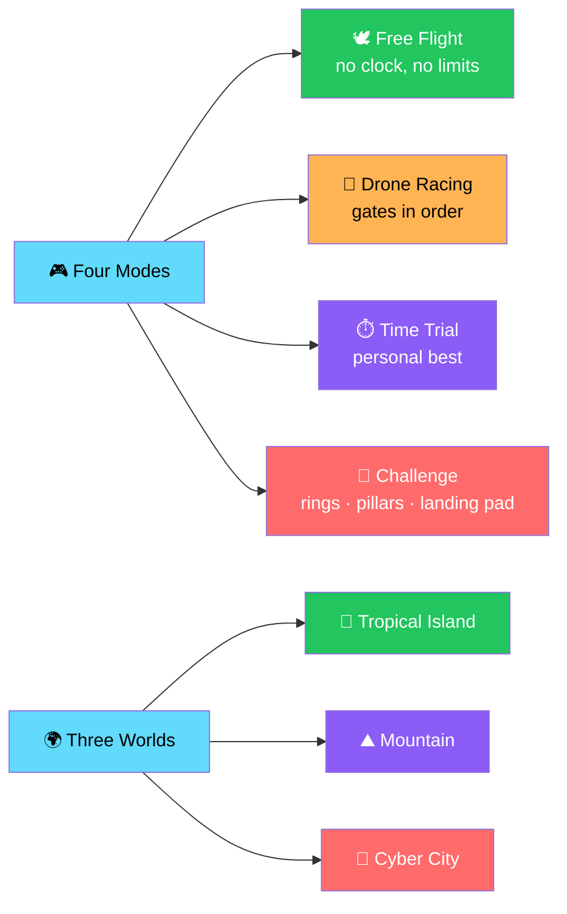
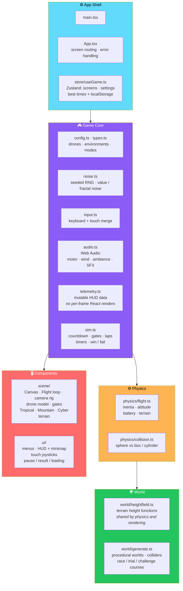

# 🚁 SKYFLY 3D — Ultimate Drone Flying Simulator

<div align="center">


**A browser-based 3D drone simulator.**

*Tropical islands · Mountain ranges · Cyber cities — everything generated procedurally*

[🚀 Run It](#-run-it) • [🎮 Controls](#-controls) • [🎯 Modes](#-modes) • [🏗️ Architecture](#️-architecture) • [⚙️ Notes](#-notes)

</div>

---

## 📖 Overview

**SKYFLY 3D** is a **browser-based 3D drone simulator** built with **React, TypeScript, Vite, Three.js *(React Three Fiber)*, drei, Tailwind CSS, and Zustand**.

### Core Idea

> **Everything is generated procedurally — there are no asset files to download.**
>
> Terrain, buildings, palms, the drone, and sound are all built in code.

### What You Get



---

## 🚀 Run It

**Requires Node.js 18 or newer.**

```bash
npm install
npm run dev        # development server (also reachable from your phone on the same network)
npm run build      # typecheck + production build into dist/
npm run preview    # serve the production build
```

**Open the URL Vite prints.**

> 💡 **For phone testing**, open the **"Network"** address on the same Wi-Fi.

---

## 🎮 Controls

### ⌨️ Keyboard

<div align="center">

| Key | Action |
|:---:|--------|
| **W / S** | Forward / backward |
| **A / D** | Strafe left / right |
| **Arrow Up / Down** | Ascend / descend |
| **Q / E** *(or Left / Right arrows)* | Yaw left / right |
| **Shift** | Boost |
| **Space** | Emergency brake / hover |
| **C** | Switch chase / FPV camera |
| **R** | Reset drone to the start |
| **Esc** | Pause / resume |

</div>

### 📱 Touch

<div align="center">

| Control | Action |
|:-------:|--------|
| **Left stick** | Moves *(forward/back, left/right)* |
| **Right stick** | Climbs / descends and yaws |
| **Boost and Brake** | Hold buttons |
| **Cam / Pause / Reset** | Bottom center |

</div>

> ✅ **Both sticks and buttons work at the same time.**

### ⚙️ Touch Customization

**Settings has:**

- **Control size**
- **Left-handed swap**

---

## 🎯 Modes

<div align="center">

| Mode | Description |
|:----:|-------------|
| 🕊️ **Free Flight** | **No clock, no limits** · **battery recharges when landed** |
| 🏁 **Drone Racing** | **Pass every gate in order** · **multiple laps on the island and city** |
| ⏱️ **Time Trial** | **One course** · **personal best saved per world and drone** |
| 🎯 **Challenge** | **Rings · tall pillars · a landing pad** · **limited time, battery, and damage** *(8 hits ends the run)* · **land gently and slowly on the green pad to finish** |

</div>

---

## 🏗️ Architecture

### System Overview



### 📂 Project Structure

```
src/
├── main.tsx, App.tsx          app shell · screen routing · error handling
│
├── store/
│   └── useGame.ts             Zustand store
│                              (screens, settings, best times)
│                              + localStorage
│
├── game/
│   ├── config.ts, types.ts    drones · environments · modes
│   │                          shared types
│   ├── noise.ts               seeded RNG · value / fractal noise
│   ├── input.ts               keyboard + touch input merge
│   ├── audio.ts               Web Audio: motor · wind
│   │                          ambience · SFX
│   │                          (no audio files)
│   ├── telemetry.ts           mutable HUD data
│   │                          (no per-frame React renders)
│   ├── sim.ts                 mode rules: countdown, gates
│   │                          laps, timers, win / fail
│   │
│   ├── physics/
│   │   ├── flight.ts          drone flight model
│   │   │                      (inertia, attitude, battery, terrain)
│   │   └── collision.ts       sphere vs box / cylinder colliders
│   │
│   └── world/
│       ├── heightfield.ts     terrain height functions
│       │                      shared by physics and rendering
│       └── generate.ts        procedural worlds, colliders
│                              race / trial / challenge courses
│
└── components/
    ├── scene/                 Canvas · Flight loop · camera rig
    │                          drone model · gates
    │                          Tropical / Mountain / Cyber environments
    │                          terrain
    └── ui/                    menus · HUD + minimap
                               touch joysticks
                               pause / result / loading
```

### Design Principles

<div align="center">

| Principle | Implementation |
|-----------|---------------|
| **🎨 Everything is procedural** | Terrain, buildings, palms, drone, and sound — **no asset files** |
| **🌍 One heightfield, two consumers** | `world/heightfield.ts` is used by **both physics and rendering** — **the drone always collides with what you see** |
| **⚡ HUD data avoids React re-renders** | `telemetry.ts` holds **mutable HUD data** — **no per-frame React renders** |
| **🎮 Input is merged, not duplicated** | `input.ts` **merges keyboard and touch** into one source of truth |
| **🔊 Audio is synthesized** | Web Audio generates **motor, wind, ambience, and SFX** — **zero audio files** |
| **⚙️ Quality scales honestly** | **Low** lowers resolution, removes shadows and post-processing, and thins vegetation |
| **💾 Everything persists** | Settings, selected drone / world / mode, and best times — all in **localStorage** |
| **⏸️ Pauses on blur** | The page **auto-pauses when the tab loses focus** |
| **🔒 Dependencies are pinned** | `postprocessing` is pinned to `~6.36.7` — **newer versions require a newer three.js than 0.166** |

</div>

---

## ⚙️ Notes

### 🎚️ Quality Settings

**Settings has Low *(performance)*, Medium, and High.**

<div align="center">

| Quality | What Changes |
|:-------:|-------------|
| **Low** | **Lowers resolution** · **removes shadows and post-processing** · **thins out vegetation** |
| **Medium** | Balanced |
| **High** | Full effects |

</div>

### 🏎️ Speed Feel

> **FOV kick · camera shake · speed-line vignette · (High) chromatic aberration.**

> ⚠️ **A true per-pixel motion blur is NOT included.**

### 💾 Persistence

> **All settings, selected drone / world / mode, and best times persist in localStorage.**

### ⏸️ Auto-Pause

> **The page auto-pauses when the tab loses focus.**

### 📦 Pinned Dependency

> **`postprocessing` is pinned to `~6.36.7`** because **newer versions require a newer three.js than 0.166**.

---

## 🗺️ Roadmap

### ✅ Current

- [x] React + TypeScript + Vite foundation
- [x] Three.js via React Three Fiber with drei helpers
- [x] Tailwind CSS styling and Zustand state
- [x] **Fully procedural worlds** — no asset files
- [x] Three worlds — Tropical, Mountain, Cyber
- [x] Procedural terrain with shared heightfield for physics and rendering
- [x] Procedural buildings and palms
- [x] Procedural drone model
- [x] Synthesized audio — motor, wind, ambience, and SFX
- [x] **Four game modes** — Free Flight, Drone Racing, Time Trial, Challenge
- [x] Free Flight with no clock or limits and battery recharge when landed
- [x] Drone Racing with gates and multiple laps
- [x] Time Trial with per-world and per-drone personal bests
- [x] Challenge mode with rings, tall pillars, a landing pad, time, battery, and damage limits
- [x] Gently landing on the green pad to finish the challenge
- [x] **Inertia-based flight model** — attitude, battery, terrain interaction
- [x] **Sphere vs box / cylinder collision**
- [x] **Seeded RNG and fractal noise** for deterministic world generation
- [x] **Keyboard and touch input merged** into a single source
- [x] **Mutable telemetry** to avoid per-frame React re-renders
- [x] Mode rules — countdown, gates, laps, timers, win / fail
- [x] Chase and FPV cameras
- [x] Boost, emergency brake, and reset
- [x] Pause and resume
- [x] **Touch controls** — dual sticks and hold buttons that work simultaneously
- [x] **Control size and left-handed swap** in Settings
- [x] **Three quality presets** — Low, Medium, High
- [x] FOV kick, camera shake, and speed-line vignette
- [x] Chromatic aberration at High quality
- [x] **Persistent settings, selections, and best times** in localStorage
- [x] Auto-pause when the tab loses focus
- [x] Pinned `postprocessing` dependency for three.js compatibility
- [x] HUD with minimap
- [x] Loading, result, and error screens

### 🔜 Future Ideas

- [ ] **True per-pixel motion blur** — currently FOV kick and vignette only
- [ ] **Additional worlds** beyond Tropical, Mountain, and Cyber
- [ ] **Additional drones** beyond the current roster
- [ ] **Additional course types** for racing and challenge
- [ ] **Ghost replay** — race your own best run
- [ ] **Local leaderboards** per world, drone, and mode
- [ ] **Gamepad support**
- [ ] **Photo mode** — for shareable captures
- [ ] **Wind and weather effects** — affecting flight feel
- [ ] **PWA support** — install and play offline

---

## 🤝 Contributing

Contributions are welcome. Please:

1. Fork the repository
2. **Keep everything procedural** — no asset files
3. **Keep the heightfield shared** — physics and rendering must use the same terrain
4. **Keep HUD data out of React state** — per-frame values belong in `telemetry.ts`
5. **Keep input merged** — keyboard and touch flow through `input.ts`
6. **Preserve the quality presets** — Low must remain genuinely playable on weak hardware
7. **Do not bump `postprocessing` without verifying three.js compatibility**
8. **Preserve localStorage compatibility** without a migration path
9. **Keep the auto-pause on tab blur**
10. Submit a Pull Request

### Guidelines

- **Never duplicate terrain height logic** — one source, two consumers
- **Never render HUD values from React on every frame**
- **Never require a backend** — the simulator must work offline after install
- **Never remove the FPV camera** — it's part of the speed feel
- **Never present a stub as a feature**

---

## 📜 License

MIT — see [LICENSE](LICENSE) for details.

---

## 🙏 Acknowledgments

- **Three.js and React Three Fiber** — for making a drone sim feel like a React component tree
- **drei** — for the helpers that make camera rigs and environments approachable
- **Zustand** — for state that stays out of the way
- **Web Audio API** — for a simulator with zero audio files
- **Every drone pilot who's ever wanted a place to practice** — this one's for you

---

<div align="center">

### 🚁 TAKE OFF. FLY. RACE. LAND.

**A browser-based 3D drone simulator.**

**Everything procedural. Nothing to download.**

<br>

⭐ If SKYFLY 3D lifted you off the ground, consider giving it a star.

<br>

[⬆ Back to Top](#-skyfly-3d---ultimate-drone-flying-simulator)

</div>
